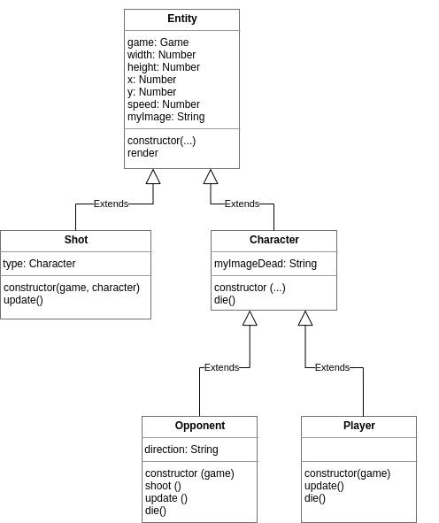

# Shooter

Juego de disparos hecho con HTML, CSS y JavaScript para la práctica de clases, booleanos, cadenas y manejo de eventos.

Controlamos un cuadrado en la parte de abajo de la pantalla y tenemos que disparar a un triángulo que se mueve por la pantalla y nos dispara. Cuando lo derrotamos aparece el jefe final (un pentágono), que se mueve el doble de rápido. Si lo derrotamos también, ganamos la partida.

## Cómo jugar

- **Online:** https://laita7.github.io/laita7.shooter/
- **En local:** abrir el archivo `index.html` con el navegador.

Controles:

| Tecla | Acción |
|---|---|
| ← / → | Mover el personaje |
| Espacio | Disparar |
| Esc / Q | Pausar o reanudar |

En móvil se puede jugar con la pantalla táctil: deslizar el dedo para moverse y tocar para disparar. El botón **NEW GAME** reinicia la partida.

## Tareas realizadas

### Tarea 1: Puntuación
- Nuevo atributo `score` en la clase `Game`, que empieza en 0.
- En el método `collide()` de `Opponent` se suma un punto cada vez que se derrota a un oponente.

### Tarea 2: Vidas
- Nueva constante `PLAYER_LIVES = 3` en `main.js` y atributo `lives` en la clase `Player`.
- En el método `collide()` de `Player`, cuando nos alcanza un disparo se resta una vida:
  - Si quedan vidas, el jugador "muere" durante 2 segundos y después revive.
  - Si no quedan vidas, muere del todo y se llama a `endGame()`.
- En `index.html` se ha añadido una lista con dos elementos (`scoreli` y `livesli`) que muestran la puntuación y las vidas. Se actualizan con `innerHTML` desde el método `updateInfo()` de `Game`.

### Tarea 3: Jefe final
- Nueva clase `Boss` en `Boss.js`, que hereda de `Opponent`. Solo sobrescribe el constructor para cambiar las imágenes (`boss.png` y `boss_dead.png`) y poner el doble de velocidad.
- En `removeOpponent()` de `Game`, al derrotar al triángulo aparece el `Boss`, y al derrotar al `Boss` se termina la partida.
- En `endGame()`, si el jugador termina con más de 0 vidas se muestra `you_win.png`, y si no, `game_over.png`.

## Estructura del proyecto

| Archivo | Contenido |
|---|---|
| `index.html` | Página del juego, importa todos los scripts |
| `game.css` | Estilos del juego |
| `main.js` | Constantes del juego y arranque |
| `Game.js` | Clase `Game`: lógica principal, eventos, colisiones y fin de partida |
| `Entity.js` | Clase `Entity`: cualquier elemento dibujado en el juego |
| `Character.js` | Clase `Character`: personajes con vida (hereda de `Entity`) |
| `Player.js` | Clase `Player`: el jugador (hereda de `Character`) |
| `Opponent.js` | Clase `Opponent`: el triángulo enemigo (hereda de `Character`) |
| `Boss.js` | Clase `Boss`: el jefe final (hereda de `Opponent`) |
| `Shot.js` | Clase `Shot`: los disparos (hereda de `Entity`) |
| `assets/` | Imágenes del juego |
| `tests/` | Tests de corrección automática |

Jerarquía de clases:

